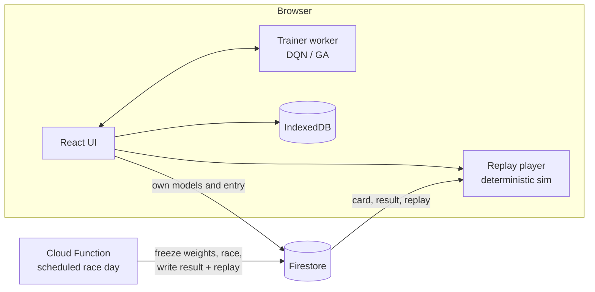

# RL Arena

[](https://github.com/RotshildGuy/rl-arena/actions/workflows/ci.yml)
[](https://github.com/RotshildGuy/rl-arena/actions/workflows/deploy.yml)
[](LICENSE)

**A daily motorsport championship where the drivers are reinforcement-learning models trained in the browser.**

Players shape a reward function with ten sliders, train a driver (DQN or a genetic algorithm) in a Web Worker, and enter it into the championship. Every evening at 20:00 Israel time a server-side Grand Prix runs qualifying, heats and a final, and the race is broadcast live to every client in sync.

**Live:** <https://rl-arena.web.app> (Hebrew and English, works on mobile)

## Highlights

- **Neural networks and RL from scratch.** A hand-written MLP in TypeScript (forward/backward pass, Adam, gradient clipping) with no ML library and no GPU. Double DQN with a replay buffer, a target network and Huber loss, plus a neuroevolution trainer.
- **Multi-agent training.** Up to four models learn in one shared environment, each with its own network and reward table, so they learn to race in traffic.
- **Deterministic simulation.** A seeded 2D car-physics engine with tyre grip limits, drifting and wall impacts. Replays store only the actions each car took, run-length encoded (about 8 KB per car per session), and re-simulate the race exactly.
- **Server-authoritative race day.** A scheduled Cloud Function freezes every entered car's weights at the entry deadline, builds the grid, runs the whole day and writes the results and replays. Clients cannot write results or read other players' weights.
- **Synced live broadcast.** The simulation step comes from wall-clock time, not a frame counter, so every viewer sees the same corner at the same second. Late joiners and background tabs catch up silently.
- **Offline-first.** Without Firebase the whole app, the championship included, runs locally on IndexedDB.

## Tech stack

| Area | Tools |
|---|---|
| Frontend | React 19, TypeScript (strict), Vite, Zustand, Canvas 2D |
| ML / simulation | Custom MLP, Double DQN, genetic algorithm, Web Workers |
| Backend | Firebase Auth (Google, email, anonymous), Firestore, Cloud Functions v2 (scheduled) |
| Hosting / CI | Firebase Hosting, GitHub Actions (CI, per-branch preview channels, deploy on `main`) |
| Testing | Vitest unit tests, plus a sanity suite for the learning core and championship rules |

## Architecture



```
src/
  core/
    nn/        MLP (forward, backward, Adam) and weight serialisation
    rl/        DQN, genetic algorithm, replay buffer, multi-learner training session
    games/     game contract and the racing env: physics, sensors, rewards, rendering
    champ/     schedule, grid and heats, scoring, standings, replays, records
  server/      the race day the Cloud Function runs (same code as the client)
  workers/     training and local race-day workers
  storage/     IndexedDB and Firestore adapters
  ui/          screens, components, state
  i18n/        Hebrew and English dictionaries, typed against each other
functions/     Cloud Functions entry point (bundles src/server at deploy time)
scripts/       sanity suite, benchmarks, house-driver training, tooling
```

## How the learning works

**Observation (24 values):** nine ray-cast wall distances, velocity in the car's frame, the direction and distance to the next two checkpoints, and the relative position and velocity of the two nearest opponents (zero-padded when alone, so the input size never changes).

**Actions (9):** gas / coast / brake times left / straight / right.

**Reward:** ten channels (checkpoints, laps, finishing, speed, wall hits, car contact, reversing, idling, time pressure, overtakes), each set by a 1-10 slider and mapped to hidden weights. Wall penalties apply on impact rather than per step, because a continuous penalty teaches the agent that parking is cheaper than driving.

| | DQN | Genetic algorithm |
|---|---|---|
| Per step | one gradient update | simulation only |
| Throughput (4 cars) | ~1,800 env steps/s | ~45,000 env steps/s |
| Sample efficiency | high, converges in ~90 episodes | low |
| Default on | desktop | mobile (no gradients to compute) |

Default network: `24 -> 64 -> 64 -> 9`, about 34 KB as base64. The gradient step dominates training time (`scripts/bench.ts`), which is why the defaults stay small.

## Championship rules in brief

- One round a day, eight rounds a season, four circuits per season drawn from a pool with a seeded shuffle, so every client agrees without a server call.
- Solo qualifying sets the grid. Fields above ten cars race serpentine-seeded heats into a final.
- Standard 25-18-15-12-10-8-6-4-2-1 scoring, +1 for the fastest lap. A car that covers less than half the winner's distance is not classified.
- Two cars per team. Team names are unique per account, and the server enforces both when it builds the grid.
- Results and race cards are write-once. Exact weight copies of another team's car are fingerprinted and flagged.

## Security model

- The Firebase web config is a public identifier, served to every browser. Access is enforced by Firestore security rules, which are kept outside the repository and deployed manually, so no automated workflow can overwrite them.
- `users/{uid}/...` is private to its owner. `arena/{id}` is readable by signed-in users, writable only by the car's owner, with every field typed and size-capped. Weights under `arena/{id}/data` are owner-only.
- Race cards, frozen weights, results and replays are written only by the server (Admin SDK). Results and replays become readable at lights-out.
- User-chosen names are checked for links, email addresses and invisible bidi characters on the client and length-capped again in the rules.
- Fonts are self-hosted, and the hosting config sets `nosniff`, a strict referrer policy and a restrictive permissions policy.

## Running locally

```bash
npm ci
npm run dev          # http://localhost:5173, fully local without Firebase
```

To connect a Firebase project, copy `.env.example` to `.env.local` and fill in the web app config.

| Command | What it does |
|---|---|
| `npm test` | Vitest unit tests |
| `npm run sanity` | gradient check, XOR, DQN and GA learning, physics, schedule, scoring, replay determinism |
| `npm run typecheck` | strict TypeScript over app and scripts |
| `npm run build` | production build into `dist/` |
| `npm run champ` | run a full championship day from the command line |

## Deployment

- Every push and pull request runs CI: typecheck, unit tests and the sanity suite.
- Every branch other than `main` is built and published to its own Firebase Hosting preview channel.
- A push to `main` runs the same checks and deploys to production. The deploy refuses to publish a build that is missing the Firebase config.
- Cloud Functions are deployed manually (`firebase deploy --only functions`), which bundles `src/server` into the function first.

## License

[MIT](LICENSE). Bundled fonts (Heebo, JetBrains Mono) are under the SIL Open Font License, included in `public/fonts`.
